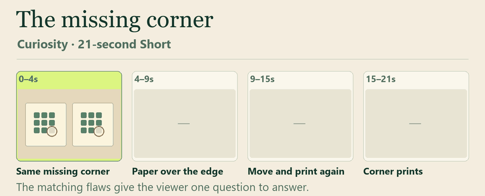
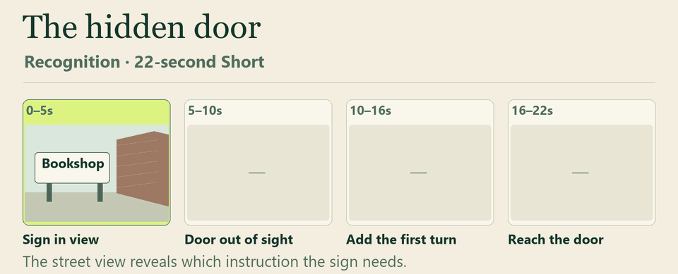
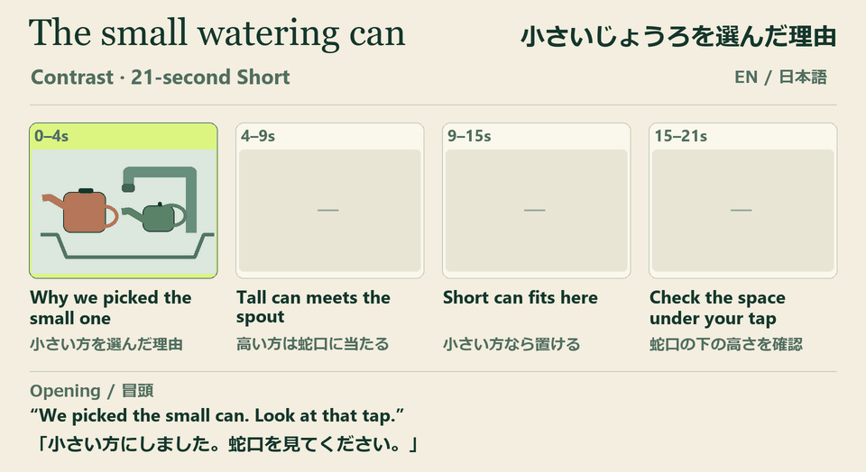

# Earned Attention

[English](README.md) · **日本語**

**撮った映像、どこから見せよう？**

Earned Attentionは、YouTube Shorts、Instagramリール、TikTok向けの短い動画を作るためのエージェント用スキルです。手持ちの映像と普段の話し方をもとに、最初に見せるカット、冒頭のひと言、次につなぐカットを提案します。秒数つきの台本や画面に出すテロップも頼めます。

## インストール

プロジェクトのフォルダーで次のコマンドを実行します。選択画面が出たら、使っているエージェントを選んでください。

```bash
npx skills add RobTar97/earned-attention
```

Codexでは `$psychological-content-strategy` で呼び出せます。[エージェントを指定する方法と全プロジェクトで使う設定（英語）](docs/installation.md)

## そのまま使える依頼文

動画を添付して、作りたい動画と普段の話し方を伝えます。たとえば、お店の入口を案内するなら、こんなふうに頼めます。

```text
psychological-content-strategy を使ってください。
初めて来るお客さん向けに、本屋の入口を案内する20秒くらいの動画を作りたいです。
通りから見た看板、角を曲がるところ、お店の扉を撮りました。
店頭でお客さんに話しかけるときのように、親しみやすく落ち着いた言葉でお願いします。
今ある映像に合う冒頭のひと言を3案出して、どれが一番合うか、理由も教えてください。
選んだ案で、最初に見せるカットから入口に着くところまで、秒数とテロップつきの台本にしてください。
```

## 英語・日本語で見比べるショート動画の作例

3本とも、英語版と日本語版で同じ映像とカット順を使っています。GIFでは、どのカットで何を伝えるかを見比べられます。[両言語のナレーション・テロップ・秒数つき台本](skills/psychological-content-strategy/references/shorts-story-examples.md)

### 同じ角だけが欠けるスタンプ

スタンプを押した2枚の紙は、どちらも同じ角が欠けています。冒頭でその共通点を見せ、紙の位置を変えて押し直すと角まで模様が写ることを確かめます。



### 通りから見えない本屋の入口

看板は見えるのに入口が見つからない。その場で迷ったお客さんの目線から始め、矢印を足した看板と、曲がった先の扉を見せます。



### 小さいじょうろを選んだ理由

大きいじょうろは蛇口に当たり、小さい方は立てたまま水を入れられます。使う場所で比べると、小さい方を選んだ理由がひと目で伝わります。


