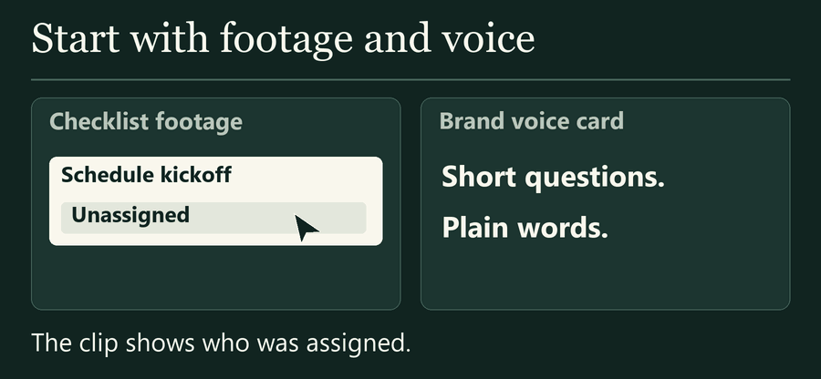
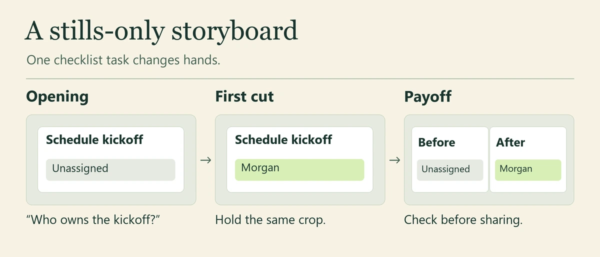
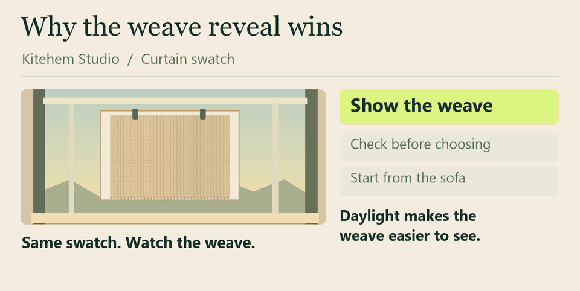

# Earned Attention

**You’ve got the footage. What do you open with?**

Earned Attention finds a moment worth showing, writes a hook that sounds like your brand, and tells you where to cut next. It’s an agent skill for short-form video, from the first line to the edit plan.

[](https://github.com/RobTar97/earned-attention/actions/workflows/validate.yml)
[](LICENSE)
[](https://skills.sh/RobTar97/earned-attention)



The clip shows an assignment. The voice card calls for short questions. **“Who owns the kickoff?”** fits both, and the next cut answers it.

[Try it on your footage](#quick-start) · [Open the GIF](docs/assets/hook-selection-demo.gif) · [Read the demo](#see-a-sample)

## Quick start

Run this from your project and pick your agent when prompted.

```bash
npx skills add RobTar97/earned-attention
```

Attach a clip and point the agent to your project voice card. A few lines describing how you write also work.

```text
Use psychological-content-strategy.
Use my attached clip and project voice.
Pick the first frame and write the hook.
Show me where to cut next and why.
```

In Codex, invoke it with `$psychological-content-strategy`. [Start with an idea instead](docs/examples.md#start-with-guided-questions) · [Install for a specific agent or globally](docs/installation.md)

## Pick a workflow

Write for TikTok, Instagram Reels, YouTube Shorts, or a longer educational video. You can also request copy, a script audit, or a focused retention test.

| Start with | Get back | Try it |
|---|---|---|
| A rough idea or a brief | Hook options, a recommendation, or a timed script | [Guided start](docs/examples.md#start-with-guided-questions) · [Product Reel](docs/examples.md#1-create-a-product-demo-reel) |
| Clips or stills | An opening sourced to a clip time or still, with copy, crop, and the next cut | [Footage-first example](docs/examples.md#15-pick-an-opening-from-stills) |
| A useful tip and a relevant offer | Three hooks and a timed edit that delivers the tip before the invitation | [Watch the bilingual example](#one-swatch-two-languages) |
| A brand voice to reuse across briefs in one project | A project card with approved lines and voice cues | [Brand voice card](skills/psychological-content-strategy/references/project-brand-voice.md) |
| A draft or retention data | A prioritised rewrite or a test of one plausible cause | [Rewrite a Short](docs/examples.md#2-repair-a-weak-educational-short) · [Read a retention chart](docs/examples.md#3-interpret-a-retention-chart) |
| Customer notes, an offer, or a content goal | Supported creative angles, finished copy, or a content plan | [Discover angles](docs/examples.md#12-build-angles-from-bounded-customer-evidence) · [Write copy](docs/examples.md#4-write-concise-headlines-and-catchcopy) |

## See a sample

The GIF illustrates a fictional checklist demo. The footage shows **Schedule kickoff** changing from **Unassigned** to **Morgan**. The project voice card says to use short questions and plain words.

| Decision | Why it fits |
|---|---|
| Set aside “Run projects faster.” | The clip shows an assignment and supplies no timing evidence. |
| Open with “Who owns the kickoff?” | A short, plain question gives the viewer a specific row to watch. |
| Cut to Morgan in the same crop. | The visible change answers the question and leaves room to read the row. |



[Read the stills-only handoff](docs/examples.md#15-pick-an-opening-from-stills) · [Browse all 44 worked hooks](skills/psychological-content-strategy/references/hook-library.md)

### One swatch, two languages

In Kitehem Studio’s fictional curtain demo, the backing card slides away and daylight makes the weave easier to see. We picked that close-up because the shot proves the point and a short observation suits the studio’s helpful voice. Both versions use the same shot.



**English:** “Same fabric. Look at the weave in the light.”

**日本語**　「同じ生地です。光を通すと、織り目が見えてきます。」

[Open the GIF](docs/assets/kitehem-bilingual-demo.gif) · [Read both 26-second scripts and the other hook options](skills/psychological-content-strategy/references/utility-led-worked-example.md)

## Documentation

| I want to… | Read |
|---|---|
| Install, update, or remove the skill | [Installation](docs/installation.md) |
| Copy a prompt for a specific task | [Example prompts](docs/examples.md) |
| Understand how the agent chooses and writes | [Workflow and reference map](docs/workflow.md) |
| Inspect the checks and source material | [Evidence and evaluations](docs/evidence.md) |
| Read or improve the skill | [SKILL.md](skills/psychological-content-strategy/SKILL.md) · [Contributing](CONTRIBUTING.md) · [Changelog](CHANGELOG.md) |

[MIT license](LICENSE) for original project material. See [source notes](skills/psychological-content-strategy/references/sources-evidence.md) for attribution.
