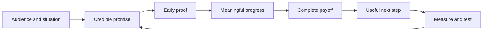

# Earned Attention

**Hooks, scripts, copy, and retention audits for AI agents.**

[](https://github.com/RobTar97/earned-attention/actions/workflows/validate.yml)
[](LICENSE)
[](https://skills.sh/RobTar97/earned-attention)

Turn an idea or a weak draft into content a viewer has a reason to watch—and a payoff worth staying for.

Earned Attention is a reusable agent skill for TikTok, Instagram Reels, YouTube Shorts, marketing copy, and content planning. It combines audience psychology with concrete scripting, production decisions, and honest measurement. Give your agent a brief, script, or retention data; get creative you can use and a focused next experiment.

## Install

```bash
npx skills add RobTar97/earned-attention --skill psychological-content-strategy
```

Choose your agent in the installer. For a project installation targeting Codex directly:

```bash
npx skills add RobTar97/earned-attention --skill psychological-content-strategy --agent codex
```

The npm [`skills` CLI](https://www.npmjs.com/package/skills) downloads the skill from this GitHub repository. The command and layout follow the [official CLI documentation](https://skills.sh/docs/cli) and [upstream skill format](https://github.com/vercel-labs/skills#creating-skills).

Need global installation, Claude Code, Windows copy mode, updates, or troubleshooting? Read [Installation](docs/installation.md).

## Try it

```text
Use psychological-content-strategy to write a 30-second Reel for a
project checklist app. It saves and reuses checklists; it does not
automate tasks. Audience: small agency team leads. Give three hook
angles, a timed script, screen-demo directions, and one free-trial CTA.
```

In Codex, you can explicitly invoke `$psychological-content-strategy`. Invocation and automatic discovery vary by agent; the installed skill's name and description help the agent select it.

Provide the audience, desired outcome, available proof, and production limits. The skill works with partial briefs, but it labels assumptions and missing evidence rather than inventing features or results.

## What you get

| Request | Deliverable |
|---|---|
| Create a short | Distinct hook angles, a selected opening, timed beat table, capture/edit notes, and one test |
| Improve a draft | Prioritized problems tied to the supplied evidence, followed by a complete rewrite |
| Write copy | Headlines, catchcopy, captions, or sales copy matched to audience awareness and voice |
| Diagnose retention | Observations, plausible explanations, evidence gaps, and a controlled-variable experiment |
| Plan a series | Audience moments, useful messages, proof, brand cues, CTAs, and separate recognition/acquisition measures |

English is supported by default; Japanese catchcopy and localization guidance are available when requested. Examples include product demonstrations, educational Shorts, project-checklist copy, and brand/trial content plans.

The [hook-pattern guide](skills/psychological-content-strategy/references/hook-patterns.md) adds 24 confession, experiment, contrarian, and lesson starters, with truth requirements, matching payoffs, and a method for studying successful creative.

## How it works



1. Understand the viewer's situation and the asset's job.
2. Choose a relevant message and an answerable curiosity gap.
3. Match the first frame, spoken opening, headline, and sound.
4. Deliver proof and small payoffs through meaningful beats.
5. Make editing, captions, and audio support understanding.
6. Connect the ending to one appropriate next step.
7. Test the largest uncertainty with clear measures and guardrails.

The skill uses psychology to improve relevance, clarity, trust, and memory. It qualifies numerical rules, avoids invented evidence, and treats retention-curve patterns as hypotheses. It does not promise virality or neurochemical effects from editing.

## A sample output

For a 30-second demonstration, expect a table like this, expanded into shootable beats:

| Time | Spoken line | Visual/proof | On-screen copy | Audio/edit | Purpose |
|---|---|---|---|---|---|
| 0–3 | A specific, supported promise | Show the actual output | One clear headline | Voice starts immediately | Relevance and proof |
| 3–22 | Explain the workflow in useful steps | Demonstrate the real controls | Progress labels | Cut on meaningful change | Comprehension and progress |
| 22–27 | State the completed result | Hold the finished example | Concise takeaway | Give the result reading time | Payoff |
| 27–30 | One appropriate action | Clear destination or next step | One CTA | Simple ending | Action |

Timing is a production plan until rehearsed. See [Example prompts](docs/examples.md) and the [worked examples](skills/psychological-content-strategy/references/templates-examples.md).

## Documentation

- [Installation](docs/installation.md): install, inspect, update, remove, and troubleshoot.
- [Example prompts](docs/examples.md): practical briefs for each mode.
- [Workflow and reference map](docs/workflow.md): what the agent reads and returns.
- [Evidence and evaluations](docs/evidence.md): source provenance, qualifications, and testing limits.
- [Skill instructions](skills/psychological-content-strategy/SKILL.md): the complete agent workflow.
- [Contributing](CONTRIBUTING.md): improve the skill, docs, and examples.

## Repository layout

```text
skills/psychological-content-strategy/
  SKILL.md                       # Main workflow and routing
  LICENSE                        # License travels with installed copies
  references/                    # Seven focused guides + source fingerprints
docs/                            # Human-facing documentation
evals/                           # Three sample tasks and evaluation summary
scripts/validate.py              # Dependency-free structural validation
skills.sh.json                   # Catalog display configuration
```

The runtime skill consists of Markdown, a source-provenance JSON file, and its license. It has no required API keys, application dependency, or executable runtime code. Browsing or media tools are used only when the requested task needs them. Actual recording, rendering, and publishing use a separate authorized workflow.

## Validation

```bash
python scripts/validate.py
npx skills add . --list
```

The initial version was checked with three task pairs: product-demo scripting, retention audit/rewrite, and bilingual copy with a brand/acquisition plan. The skill-assisted responses passed 24/24 workflow expectations; the baseline passed 22/24. These small, author-graded checks demonstrate specified behavior, not measured audience retention or conversion lift. Details are in [Evidence and evaluations](docs/evidence.md).

## License and attribution

[MIT](LICENSE), for this repository's original skill instructions, synthesis, documentation, and examples. Linked studies, books, platform documentation, and source materials remain subject to their respective rights and terms. The original supplied playbooks are acknowledged in [source notes](skills/psychological-content-strategy/references/sources-evidence.md) and are not redistributed in full.

Maintained by [RobTar97](https://github.com/RobTar97). See [CHANGELOG.md](CHANGELOG.md) for releases.
