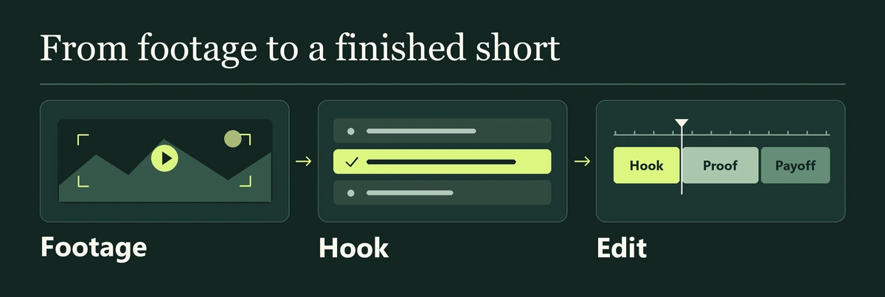

# Earned Attention

**An agent skill for short-form video hooks, scripts, and retention audits.**

[](https://github.com/RobTar97/earned-attention/actions/workflows/validate.yml)
[](LICENSE)
[](https://skills.sh/RobTar97/earned-attention)

Turn an idea, a rough script, or footage you already have into something you can film or edit. Use it for TikTok, Instagram Reels, YouTube Shorts, educational videos, and marketing copy.

[Quick start](#quick-start) · [Pick a workflow](#pick-a-workflow) · [See a sample](#see-a-sample) · [Documentation](#documentation)



## Quick start

Run this from your project and pick your agent when prompted.

```bash
npx skills add RobTar97/earned-attention
```

Then give your agent a task. This prompt works with an idea you’re still shaping.

```text
Use psychological-content-strategy.
Help me plan a short video for my brand.
Ask the essential questions, then give me
three hooks that fit my voice and
available footage. Let me choose.
```

In Codex, invoke it with `$psychological-content-strategy`. A complete brief can go straight to drafting. [Install for a specific agent, install globally, or troubleshoot](docs/installation.md).

## Pick a workflow

| Start with | Get back | Try it |
|---|---|---|
| A rough idea or a brief | Hook options, a recommendation, or a timed script | [Guided start](docs/examples.md#start-with-guided-questions) · [Product Reel](docs/examples.md#1-create-a-product-demo-reel) |
| Clips or stills | An opening sourced to a clip time or still, with copy, crop, and the next cut | [Footage-first example](docs/examples.md#15-pick-an-opening-from-stills) |
| A brand voice to reuse across briefs in one project | A project card with approved lines and voice cues | [Brand voice card](skills/psychological-content-strategy/references/project-brand-voice.md) |
| A draft or retention data | A prioritised rewrite or a test of one plausible cause | [Rewrite a Short](docs/examples.md#2-repair-a-weak-educational-short) · [Read a retention chart](docs/examples.md#3-interpret-a-retention-chart) |
| Customer notes, an offer, or a content goal | Supported creative angles, finished copy, or a content plan | [Discover angles](docs/examples.md#12-build-angles-from-bounded-customer-evidence) · [Write copy](docs/examples.md#4-write-concise-headlines-and-catchcopy) |

## See a sample

Two approved checklist stills show a task changing from **Unassigned** to **Morgan**. Open with **“Who owns the kickoff?”**, then cut to the same crop on the assigned row. Hold both stills side by side for the payoff.


[Read the full handoff in text](docs/examples.md#15-pick-an-opening-from-stills) · [Browse all 44 worked hooks](skills/psychological-content-strategy/references/hook-library.md)

## Documentation

| I want to… | Read |
|---|---|
| Install, update, or remove the skill | [Installation](docs/installation.md) |
| Copy a prompt for a specific task | [Example prompts](docs/examples.md) |
| Understand how the agent chooses and writes | [Workflow and reference map](docs/workflow.md) |
| Inspect the checks and source material | [Evidence and evaluations](docs/evidence.md) |
| Read or improve the skill | [SKILL.md](skills/psychological-content-strategy/SKILL.md) · [Contributing](CONTRIBUTING.md) · [Changelog](CHANGELOG.md) |

[MIT license](LICENSE) for original project material. See [source notes](skills/psychological-content-strategy/references/sources-evidence.md) for attribution.
