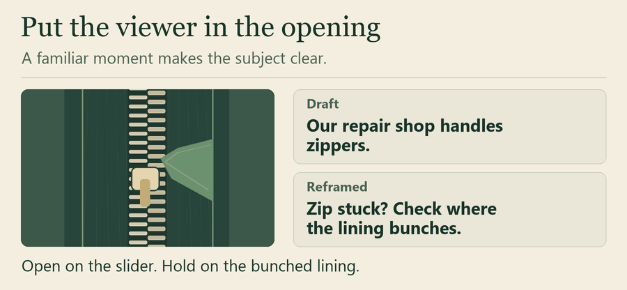
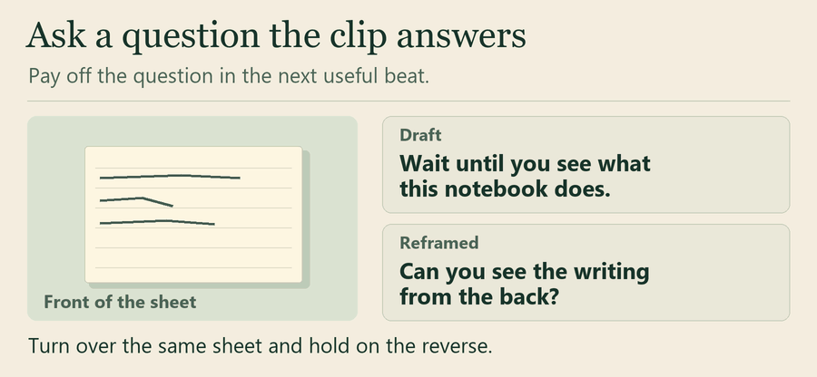
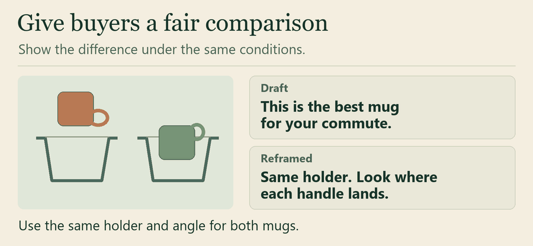
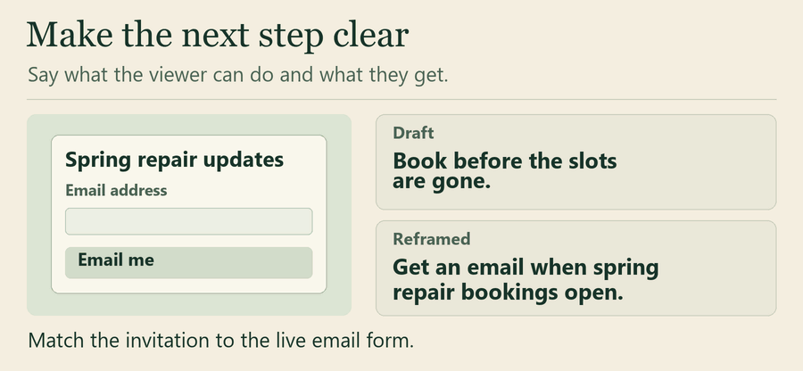

# Psychology reframes with worked GIFs

Use these examples to revise a hook, comparison, or CTA. Each GIF illustrates one change using a fictional brief. The rules turn an audience need into a writing and editing decision. For the underlying approach, see [audience psychology](psychology-brand.md#mechanism-to-creative-map), [viewer-first principles](content-principles.md), [short-form hooks](short-form-hooks.md), and [utility-led scripting](utility-led-scripting.md).

## Pick one reframe for the problem

| If the draft asks viewers to… | Reframe it around… | What the edit must show |
|---|---|---|
| Care about the brand before they recognise a need | A moment they can recognise | The actual object, action, or friction in the first frame |
| Wait for a vaguely promised reveal | One question the footage can answer | A clue early and the visible answer in the next useful beat |
| Believe a broad superiority claim | One fair, visible comparison | The same setup, the difference that matters, and the scope of the result |
| Act because the draft creates pressure | A clear voluntary next step | The real action, destination, and what happens after it |

Choose the move that answers the viewer's immediate need. Keep the subject, promise, and proof aligned. Write the new line and the first useful beat together, using the project's voice. When testing a hook, reuse the same body and CTA so the opening comparison has a clear meaning. Use the principles silently when the user only wants finished copy.

## 1. Recognition through a real moment

**Draft:** “Our repair shop handles zippers.”

**Reframed:** “Zip stuck? Check where the lining bunches.”

**First frame → next beat.** Open close on the slider with the fold in view. Point to where the material bunches and hold so someone can check their own jacket. That shot supports a check for a caught fold in this jacket.

**Why this fits.** Someone dealing with a stuck zip can recognise the problem before they need to care who made the video. Match the line to an actual recurring moment in the brief. [Viewer-first principles](content-principles.md#start-with-one-viewer-and-this-particular-idea)

## 2. Curiosity with a visible answer

**Draft:** “Wait until you see what this notebook does.”

**Reframed:** “Can you see the writing from the back?”

**First frame → next beat.** Show the ink on the front of the sheet, then flip that same sheet and hold on the reverse. If useful, give the viewer a simple way to repeat the check with their own pen.

**Why this fits.** The question names something the viewer can look for and the flip answers it promptly. The result describes one pen-and-paper sample under the shown lighting. [Calibrating curiosity](psychology-brand.md#calibrate-curiosity)

## 3. Contrast that helps a decision

**Draft:** “This is the best mug for your commute.”

**Reframed:** “Same holder. Look where each handle lands.”

**First frame → next beat.** Set the mugs into the same holder in turn. Match the angle and hold on the handle-to-rim clearance. In the illustrated setup, one handle catches the rim and the other clears it. Viewers can check that clearance in their own holder.

**Why this fits.** The contrast gives buyers a concrete criterion they can apply. The visual establishes how these mugs fit this holder. [Compare the supported result](short-form-optimization.md#select-a-structure-that-fits-the-available-proof)

## 4. Reduce uncertainty at the next step

**Draft:** “Book before the slots are gone.”

**Reframed:** “Get an email when spring repair bookings open.”

**Final beat → next step.** After the video finishes teaching one repair check, give the email invitation and show the matching form. The fictional form sends a launch notice when booking opens. Viewers can decide whether that notice is useful.

**Why this fits.** The destination answers what the CTA asks the viewer to do and what they receive. If bookings are actually open, use the booking path and the verified terms instead. [Match the CTA to the live offer](utility-led-scripting.md#match-the-cta-to-what-is-actually-available)

## Reuse the move on your footage

Take a draft line, say what the viewer needs in that moment, choose one row from the table, and write an opening the available footage can pay off. If the opening is already specific and clear, apply the reframe where the viewer hits the next uncertainty. [Footage-first handoff](footage-first.md) · [Project voice card](project-brand-voice.md)
