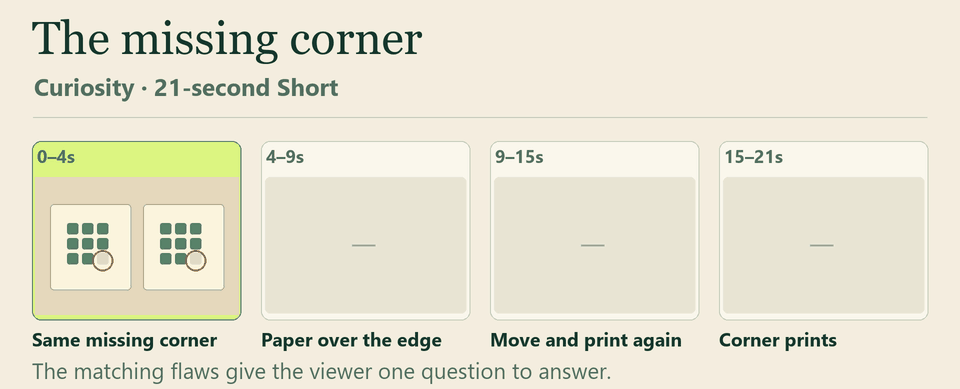

# Three Shorts scripts with animated storyboards

These fictional briefs pair an exact opening line with a visible story turn and a payoff. The GIFs are illustrated previews of the edit beats. The tables give the complete spoken scripts, selective on-screen text, and estimated edit times. Rehearse each read against the actual footage before filming or cutting.

[Curiosity · the missing corner](#1-curiosity--the-missing-corner) · [Recognition · the hidden door](#2-recognition--the-hidden-door) · [Contrast · the small watering can](#3-contrast--the-small-watering-can)

## 1. Curiosity · the missing corner

**Brief.** Ledge & Ink is a fictional print studio with a calm, hands-on voice. Its test footage shows two impressions from the same stamp missing the same corner, a side view of the paper extending past the backing board, and one repeat impression after the paper is moved fully onto the board. The viewer wants to troubleshoot an uneven print.

**Why this hook fits.** Two matching flaws give the viewer a precise question. The board edge is an early clue. The repeat answers what happened in this setup and gives viewers one check they can try.

| Edit time | Spoken line | Picture and cut | On-screen text |
|---|---|---|---|
| 0–4s | “Two prints. Why is the same corner missing?” | Start on both impressions. Keep the blank lower-right squares in the same part of the frame. | Same missing corner |
| 4–9s | “From the side, you can see the paper hanging over the board.” | Cut low to the edge. Point to the unsupported corner below the stamp’s footprint. | Paper over the edge |
| 9–15s | “I moved the paper in and pressed the same stamp again.” | Show the reposition and the repeat. Give the stamp lift time to register. | Move it onto the board |
| 15–21s | “The corner printed this time. Before you re-ink, check what’s under the paper.” | Hold on the complete repeat beside one original. | Check the backing |

The ending closes the question and gives the viewer the next check in the same line. Keep the result tied to the shown materials. [Calibrate curiosity](psychology-brand.md#calibrate-curiosity) · [Plan source shots](footage-first.md)

## 2. Recognition · the hidden door

**Brief.** Mossstep Books is a fictional bookshop with a warm, practical voice. The owner can show the original sign from the pavement, the entrance hidden around a corner, the revised sign with a right arrow, and the walk to the door. The lesson is for a local shop owner checking their own directions.

**Why this hook fits.** The opening puts the viewer in a familiar small frustration. The turn comes when the owner checks the sign from the pavement and sees which instruction is missing.

| Edit time | Spoken line | Picture and cut | On-screen text |
|---|---|---|---|
| 0–5s | “Our sign said ‘Bookshop’. From the pavement, the door was out of sight.” | Open from the street on the original sign. Hold long enough to read it and see the wall. | Bookshop. Which way? |
| 5–10s | “I tried the walk. The sign didn’t tell me where to turn.” | Walk to the corner and pause where the route changes. | Door around the corner |
| 10–16s | “We put an arrow on the sign, pointing down the passage.” | Match back to the street angle with the revised sign. Let the arrow read before cutting. | Bookshop → |
| 16–22s | “If your entrance is tucked away, show people the first turn.” | Follow the turn to the shop door. End on the entrance the sign leads to. | Show the first turn |

The story shows what the sign now tells a visitor and how the route works on this walk. Use the actual street viewpoint and the actual entrance. [Start with the viewer’s situation](content-principles.md#start-with-one-viewer-and-this-particular-idea) · [Build a useful story turn](story-arcs.md#make-each-rise-earn-its-place)

## 3. Contrast · the small watering can

**Brief.** Fern Counter is a fictional plant shop with an understated voice. The shop can film two watering cans approaching the same low tap from the same angle, the tall can meeting the spout before it’s upright, and the short can fitting and filling. The viewer waters plants in a small kitchen.

**Why this hook fits.** The unexpected choice creates a small question. Using the same tap makes the reason visible. The ending turns one shop choice into a practical buying criterion.

| Edit time | Spoken line | Picture and cut | On-screen text |
|---|---|---|---|
| 0–4s | “We picked the small can. Look at that tap.” | Start on the two cans beside the sink. Keep the low tap visible. | Why we picked the small one |
| 4–9s | “The tall one hit the spout before I could stand it upright.” | Let the tall can meet the tap in a locked side-angle shot. Keep the contact point in frame. | Tall can meets the spout |
| 9–15s | “The short one fits flat in the basin. I can fill it right here.” | Match the angle and show the short can held upright under running water. | Short can fits here |
| 15–21s | “If you fill yours at the sink, check the space under your tap first.” | Hold on the space between this basin and the spout. Give the viewer the final visual cue. | Check the space under your tap |

The two shots support a fit decision for this sink. Let the camera show the contact and clearance that matter before offering a buying tip. [Show a fair comparison](psychology-reframes.md#3-contrast-that-helps-a-decision) · [Deliver the payoff before the next step](utility-led-scripting.md)

## Reuse the approach

Choose a single reason to watch, then ask what the footage can reveal or change. Write the first line, the first visible clue, and the last useful line before filling in the middle. Use your project’s voice and adapt the overlay to the footage and placement. [Hook library](hook-library.md) · [Voice card](project-brand-voice.md) · [Production handoff](video-production.md)
