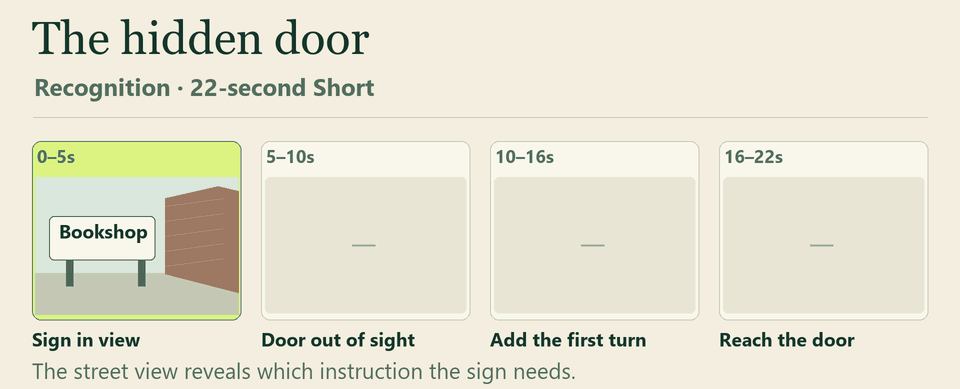
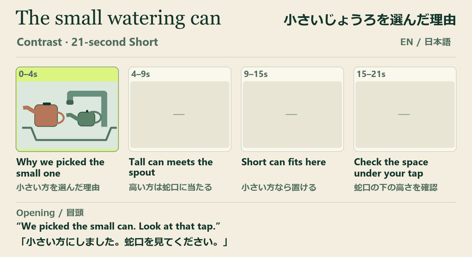

# Three Shorts scripts with animated storyboards

These fictional briefs pair an exact opening line with a visible story turn and a payoff. Each GIF shows the same edit beats with English and Japanese copy. The tables give the complete spoken scripts, selective on-screen text, and estimated edit times. Read each language aloud against the shot plan and confirm the timing with the footage.

どの作例も、英語版と日本語版で同じ映像とカット順を使います。字幕を付けるときは、画面テキストとは別にナレーションの内容を正確に載せてください。

[Curiosity · the missing corner](#1-curiosity--the-missing-corner) · [Recognition · the hidden door](#2-recognition--the-hidden-door) · [Contrast · the small watering can](#3-contrast--the-small-watering-can)

## 1. Curiosity · the missing corner

**Brief.** Ledge & Ink is a fictional print studio with a calm, hands-on voice. Its test footage shows two impressions from the same stamp missing the same corner, a side view of the paper extending past the backing board, and one repeat impression after the paper is moved fully onto the board. The viewer wants to troubleshoot an uneven print.

**Why this hook fits.** Two matching flaws give the viewer a precise question. The board edge is an early clue. The repeat answers what happened in this setup and gives viewers one check they can try.

### English

| Edit time | Spoken line | Picture and cut | On-screen text |
|---|---|---|---|
| 0–4s | “Two prints. Why is the same corner missing?” | Start on both impressions. Keep the blank lower-right squares in the same part of the frame. | Same missing corner |
| 4–9s | “From the side, you can see the paper hanging over the board.” | Cut low to the edge. Point to the unsupported corner below the stamp’s footprint. | Paper over the edge |
| 9–15s | “I moved the paper in and pressed the same stamp again.” | Show the reposition and the repeat. Give the stamp lift time to register. | Move it onto the board |
| 15–21s | “The corner printed this time. Before you re-ink, check what’s under the paper.” | Hold on the complete repeat beside one original. | Check the backing |

### 日本語 · 同じ角が欠ける

| 編集時間 | ナレーション | 映像と編集 | 画面テキスト |
|---|---|---|---|
| 0–4秒 | 「2枚とも、同じ角が欠けています。なぜでしょう？」 | 2枚の試し刷りを並べ、右下の角が分かるように映す。 | 同じ角が欠ける |
| 4–9秒 | 「横から見ると、紙の角が板からはみ出しています。」 | 台の横から撮り、紙がはみ出した角を指す。 | 紙が台からはみ出す |
| 9–15秒 | 「紙を板の内側にずらして、同じスタンプでもう一度押します。」 | 紙をずらして押し直す。スタンプを持ち上げるところまで映す。 | 紙をずらして押す |
| 15–21秒 | 「角まで押せました。インクを足す前に、紙の下を確認してみてください。」 | 押し直したものと、最初の1枚を並べて見せる。 | 紙の下を確認 |

**投稿文**　スタンプの角がうまく押せないときは、インクを足す前に、紙が台からはみ出していないか見てみてください。

The ending closes the question and gives the viewer the next check in the same line. Keep the result tied to the shown materials. [Calibrate curiosity](psychology-brand.md#calibrate-curiosity) · [Plan source shots](footage-first.md)

## 2. Recognition · the hidden door

**Brief.** Mossstep Books is a fictional bookshop with a warm, practical voice. The owner can show the original sign from the pavement, the entrance hidden around a corner, the revised sign with a right arrow, and the walk to the door. The lesson is for a local shop owner checking their own directions.

**Why this hook fits.** The opening puts the viewer in a familiar small frustration. The turn comes when the owner checks the sign from the pavement and sees which instruction is missing.

### English

| Edit time | Spoken line | Picture and cut | On-screen text |
|---|---|---|---|
| 0–5s | “Our sign said ‘Bookshop’. From the pavement, the door was out of sight.” | Open from the street on the original sign. Hold long enough to read it and see the wall. | Bookshop. Which way? |
| 5–10s | “I tried the walk. The sign didn’t tell me where to turn.” | Walk to the corner and pause where the route changes. | Door around the corner |
| 10–16s | “We put an arrow on the sign, pointing down the passage.” | Match back to the street angle with the revised sign. Let the arrow read before cutting. | Bookshop → |
| 16–22s | “If your entrance is tucked away, show people the first turn.” | Follow the turn to the shop door. End on the entrance the sign leads to. | Show the first turn |

### 日本語 · 通りから見えない入口

| 編集時間 | ナレーション | 映像と編集 | 画面テキスト |
|---|---|---|---|
| 0–5秒 | 「看板は見えるのに、通りからはお店の入口が見えません。」 | 通りから元の看板を映す。看板が読めて壁も見える位置で少し止める。 | 本屋の入口はどこ？ |
| 5–10秒 | 「歩いて気づきました。曲がる場所の案内がないんです。」 | 曲がり角まで歩き、曲がる位置で一度止まる。 | 曲がる場所の案内がない |
| 10–16秒 | 「そこで、看板に矢印を足して、通路の方を示しました。」 | 通りからの画に戻り、新しい看板の矢印の向きが分かるまで映す。 | 本屋はこちら → |
| 16–22秒 | 「入口が通りから見えないなら、最初に曲がる場所を案内してみてください。」 | 通路に沿って歩き、入口の扉で終える。 | 最初の曲がり角を案内 |

**投稿文**　入口が通りから見えないときは、お客さんと同じ道を歩いてみてください。どこで最初に曲がるか分かるように、看板に矢印を添えてみましょう。

The story shows what the sign now tells a visitor and how the route works on this walk. Use the actual street viewpoint and the actual entrance. [Start with the viewer’s situation](content-principles.md#start-with-one-viewer-and-this-particular-idea) · [Build a useful story turn](story-arcs.md#make-each-rise-earn-its-place)

## 3. Contrast · the small watering can

**Brief.** Fern Counter is a fictional plant shop with an understated voice. The shop can film two watering cans approaching the same low tap from the same angle, the tall can meeting the spout before it’s upright, and the short can fitting and filling. The viewer waters plants in a small kitchen.

**Why this hook fits.** The unexpected choice creates a small question. Using the same tap makes the reason visible. The ending turns one shop choice into a practical buying criterion.

### English

| Edit time | Spoken line | Picture and cut | On-screen text |
|---|---|---|---|
| 0–4s | “We picked the small can. Look at that tap.” | Start on the two cans beside the sink. Keep the low tap visible. | Why we picked the small one |
| 4–9s | “The tall one hit the spout before I could stand it upright.” | Let the tall can meet the tap in a locked side-angle shot. Keep the contact point in frame. | Tall can meets the spout |
| 9–15s | “The short one fits flat in the basin. I can fill it right here.” | Match the angle and show the short can held upright under running water. | Short can fits here |
| 15–21s | “If you fill yours at the sink, check the space under your tap first.” | Hold on the space between this basin and the spout. Give the viewer the final visual cue. | Check the space under your tap |

### 日本語 · 小さいじょうろを選んだ理由

| 編集時間 | ナレーション | 映像と編集 | 画面テキスト |
|---|---|---|---|
| 0–4秒 | 「小さい方にしました。蛇口を見てください。」 | シンクの横に並べた2つのじょうろと、低い蛇口を映す。 | 小さい方を選んだ理由 |
| 4–9秒 | 「背の高い方は、立てようとすると蛇口に当たります。」 | 横からカメラを固定し、背の高いじょうろが蛇口に当たるところを見せる。 | 高い方は蛇口に当たる |
| 9–15秒 | 「小さい方なら、シンクの底に置いたまま水を入れられます。」 | 同じ角度で、小さいじょうろを立てたまま水を入れる。 | 小さい方なら置ける |
| 15–21秒 | 「シンクで水をくむなら、先に蛇口の下の高さを確かめてください。」 | シンクの底と蛇口の先の間が分かる画で止める。 | 蛇口の下の高さを確認 |

**投稿文**　じょうろを選ぶときは、シンクの底から蛇口の先までの高さも見ておくと安心です。動画では、同じ蛇口で2つのじょうろを比べました。

The two shots support a fit decision for this sink. Let the camera show the contact and clearance that matter before offering a buying tip. [Show a fair comparison](psychology-reframes.md#3-contrast-that-helps-a-decision) · [Deliver the payoff before the next step](utility-led-scripting.md)

## Reuse the approach

Choose a single reason to watch, then ask what the footage can reveal or change. Write the first line, the first visible clue, and the last useful line before filling in the middle. Use your project’s voice and adapt the overlay to the footage and placement. [Hook library](hook-library.md) · [Voice card](project-brand-voice.md) · [Production handoff](video-production.md)
