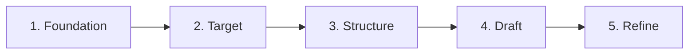
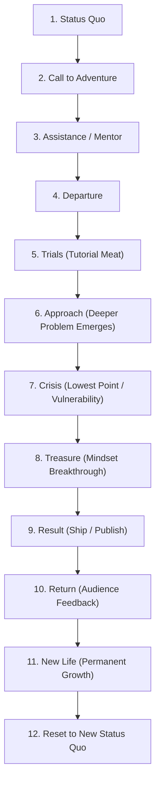

# How I Actually Write Viral Scripts: Framework & Complete Transcript

> **Source Video:** `v26044gc0000db6105nog65i9r49fm40.mp4`  
> **Creator:** Isaac ([@isaaccverse](https://www.tiktok.com/@isaaccverse))  
> **Topic:** The complete, unfiltered 5-phase framework for writing viral, high-retention YouTube video scripts with narrative depth and authentic value.  
> **Duration:** 17 minutes 33 seconds  

---

## Table of Contents
1. [Executive Summary & Core Philosophy](#executive-summary--core-philosophy)
2. [The 5-Phase Viral Scriptwriting Framework](#the-5-phase-viral-scriptwriting-framework)
   - [Phase 1: Foundation (Topic, Common Goal, Deeper Problem, Packaging)](#phase-1-foundation)
   - [Phase 2: Target (Audience Avatars & Research Gap Analysis)](#phase-2-target)
   - [Phase 3: Structure (Hero's Journey & Universe Building)](#phase-3-structure)
   - [Phase 4: Draft (AI Roasting, Freewriting & Interactive Mechanics)](#phase-4-draft)
   - [Phase 5: Refine (The "But/Therefore" Rule & Sentence Rhythm)](#phase-5-refine)
3. [The Core Climax: Authenticity vs. Retention Algorithms](#the-core-climax-authenticity-vs-retention-algorithms)
4. [Creator's Quick Reference Checklist](#creators-quick-reference-checklist)
5. [Complete Verbatim Transcript](#complete-verbatim-transcript)

---

## Executive Summary & Core Philosophy

Most YouTube advice preaches manipulative dopamine tricks: 3-second loud hooks, screaming pacing, surface-level explanations, and rage-bait endings designed solely to optimize the analytics graph.

This masterclass presents the antithesis: **Authenticity over algorithmic manipulation**.

### The Core Thesis
1. **Surface vs. Deeper Problem:** Every tutorial has an obvious technical topic (the surface problem), but truly memorable videos solve an internal, psychological struggle (the deeper problem, such as perfectionism, impatience, or fear).
2. **The Common Goal:** When the creator's true incentive aligns 100% with the viewer's learning goal, the content exudes natural authority and trust.
3. **Tutorial as Hero's Journey:** Rather than reciting bullet points, structure educational content as a hero's transformative journey—complete with departure, trials, lowest-point crisis, vulnerability, and breakthrough.
4. **AI as a Critical Partner, Not a Ghostwriter:** Never let AI write your script—it produces generic, sanitized slop lacking human struggle. Instead, use AI to mercilessly **roast your outlines** and detect blind spots.

---

## The 5-Phase Viral Scriptwriting Framework

---

### Phase 1: Foundation

#### 1. The Blank Page Trap
The biggest trap in content creation is opening a blank document and writing immediately. Without a pre-constructed architecture, your thoughts wander, pacing breaks, and the narrative unravels.

#### 2. Finding the Topic
* Seek inspiration from:
  * Viewer comments across niche channels.
  * Subreddits and community forums discussing unresolved pain points.
  * Deconstructing what other creators left unanswered.
  * Genuine personal epiphanies.

#### 3. Defining the Common Goal
Compare the viewer's reason for clicking with your reason for creating:
* **Misaligned (The Fake Guru Model):**
  * *Viewer Goal:* Wants to learn financial independence.
  * *Creator Goal:* Wants to sell a \$997 course.
  * *Result:* The video feels predatory and inauthentic.
* **Aligned (The Master Creator Model):**
  * *Viewer Goal:* Wants to master scriptwriting.
  * *Creator Goal:* Wants to write an exceptional script while breaking down the process.
  * *Result:* Complete trust and high engagement.

#### 4. Identifying the Deeper Problem
| Video Topic (Surface Problem) | The Deeper Problem (Emotional Struggle) |
| :--- | :--- |
| How to make viral shorts | Developing patience in the face of zero views |
| How to edit cinematic videos | Conquering perfectionism and shipping |
| Uploading daily for 365 days | Cultivating iron determination |
| How to write viral scripts | Choosing authenticity over soul-less algorithmic optimization |

> **Action Step:** Always write down: *"The technical skill I am teaching is [X], but the emotional demon my viewer is battling is [Y]."*

#### 5. Packaging First
Never write a script without an initial thumbnail concept and title.
* Draft thumbnail sketches in Canva or generate concept visuals using AI tools.
* The thumbnail sets the viewer's mental contract. If the script does not deliver on that specific emotional and visual promise, retention collapses within 30 seconds.

---

### Phase 2: Target

#### 1. Developing Audience Avatars
Profile distinct viewer archetypes to gauge appropriate complexity:
* **Beginner Avatar (e.g., "Socrates"):** Under 1,000 subscribers; checks analytics 500 times a day; understands terms like retention and CTR, but struggles to achieve initial momentum.
* **Intermediate Avatar (e.g., "Leonardo"):** Around 45,000 subscribers; understands advanced editing and retention; craves novel, high-level frameworks and nuanced depth.
* **Advanced Avatar (e.g., "Aristotle"):** Over 200,000 subscribers; looking for philosophy, workflow scaling, and meta-strategy.
* **Casual Fan Avatar (e.g., "Marcus"):** 3 subscribers; watches for entertainment, pacing, and comedic timing.

#### 2. Research & Finding "The Gap"
1. Spend 2–4 hours surveying high-performing videos and articles on the topic.
2. Maintain a two-column notebook:
   * **Column A (Explained):** Common knowledge, clichés, and widely repeated basics.
   * **Column B (Not Explained):** Unanswered questions, confusing leaps in logic, and skipped nuances.
3. **The Gap is your unfair advantage:** Center your entire script on answering Column B.

---

### Phase 3: Structure

#### 1. Defining the Transformation Arc
Map the emotional coordinates:
* **Point A (Start):** Where the creator/viewer begins (flawed perspective, frustration, or naivety).
* **Point B (Finish):** Where the creator/viewer finishes (hard-won wisdom, identity shift).
* *Example:* Beginning with an obsession over making the "perfect" tutorial $\rightarrow$ Ending with the realization that *"done is better than perfect."*

#### 2. The Hero's Journey Applied to Tutorials
Transform dry instructions into a cinematic quest:

#### 3. Cinematic Universe Building
Do not treat uploads as isolated one-offs. Connect recurring characters, inside jokes, unresolved meta-mysteries, and philosophy across videos to create an overarching franchise (akin to Marvel Phase 1–3).

---

### Phase 4: Draft

#### 1. The AI Roasting Protocol
* **Do NOT:** Prompt AI to generate the prose. It produces robotic cadence and bland corporate phrasing.
* **DO:** Submit your detailed outline and prompt the model:
  > *"Roast this outline mercilessly. Which points are boring? Where is the pacing dragging? What obvious angles am I missing? How can I subvert expectations in the climax?"*

#### 2. Timed Freewriting
Open your editor alongside your outline. Set a 30-minute timer and freewrite without pausing. Ban self-editing, backspacing, or dictionary checks. Extract the raw ideas from your brain first.

#### 3. Key Drafting Techniques
* **Simple-to-Complex Pacing:**
  * Do not unload dense technical jargon in minute one.
  * Start with universally relatable context, build common ground, and steadily increase depth as watch-time accrues.
* **"Ask, Don't Tell":**
  * Do not merely lecture facts.
  * Frame key lessons as active challenges: pose a riddle, show a dilemma, and let the viewer attempt to deduce the conclusion before revealing the insight.
* **Embed Visual & Sound Cues:**
  * Script stage directions, audio swells, SFX cutoffs, and visual punchlines directly alongside spoken dialogue.

---

### Phase 5: Refine

#### 1. The "But / Therefore" Rule (Trey Parker & Matt Stone Method)
Audit transitions between every paragraph:
* ❌ **"And then..."** $\rightarrow$ Flat, episodic, predictable.
* ✅ **"BUT..."** $\rightarrow$ Sudden friction, unexpected obstacles, or contradictions.
* ✅ **"THEREFORE..."** $\rightarrow$ Immediate causal consequence and dynamic forward momentum.

#### 2. Sentence Rhythm (Gary Provost's Cadence)
Avoid uniform sentence lengths. Vary syllables and cadence to create music:

> *"This sentence has five words. Here are five more words. Five-word sentences are fine. But several together become monotonous. Listen to what is happening. The writing is getting boring. The sound of it drones. It’s like a stuck record. The ear demands some variety.*  
>  
> *Now listen. I vary the sentence length, and I create music. The writing sings. It has a pleasant rhythm, a lilt, a harmony. I use short sentences. And I use sentences of medium length. And sometimes when I am certain the reader is rested, I will engage him with a sentence of considerable length, a sentence that burns with energy and builds with all the impetus of a crescendo, the roll of the drums, the crash of the cymbals—sounds that say listen to this, it is important."*  
> — **Gary Provost**

---

## The Core Climax: Authenticity vs. Retention Algorithms

Toward the climax of the video, Isaac faces his animated alter-ego, Steven, who presents an automated "AI Retention Optimizer" script:
* It stripped out the narrative friction.
* It removed difficult, nuanced explanations.
* It replaced the thoughtful ending with sensational rage-bait.
* It promised +30% watch time.

Isaac rejects it:

> **"It may have better retention, better everything... but it doesn't have a soul, man. I won't manipulate people to keep that chart high, and I won't delete actually useful parts just because they hurt retention."**

### Key Takeaways for High-Integrity Creators:
1. **Retention tricks work, but they have a moral ceiling.** Overusing them turns educational content into psychological traps.
2. **Prioritize high-value depth over shallow completion rates.** If a viewer learns a game-changing skill, they will return forever, even if a complex explanation caused a tiny dip in the retention graph.
3. **AI cannot replicate personal vulnerability, sacrifice, and struggle.** AI has never stayed up until 4:00 AM wrestling with creative doubt. Your vulnerability is the moat.

---

## Creator's Quick Reference Checklist

Before filming any script, audit against these 8 gates:

- [ ] **Common Goal:** Is my incentive 100% aligned with what the viewer clicked to learn?
- [ ] **Packaging Parity:** Does the script fulfill the exact visual and emotional promise made by the thumbnail and title within the first 45 seconds?
- [ ] **The Deeper Problem:** Have I identified the emotional/psychological obstacle underlying the technical tutorial?
- [ ] **Avatar Focus:** Which specific avatar (Beginner, Intermediate, Pro) determines the technical threshold of this video?
- [ ] **Transformation:** Is there a clear emotional arc from Point A (naive/frustrated) to Point B (empowered/enlightened)?
- [ ] **Narrative Momentum:** Are transitions linked by **"BUT"** and **"THEREFORE"** rather than "AND THEN"?
- [ ] **Interactive Questioning:** Did I include at least one *"Ask, Don't Tell"* moment that invites the viewer to guess or think?
- [ ] **Gary Provost Rhythm Test:** Read the script aloud. Are sentence lengths varied to produce natural musical cadence?

---

## Complete Verbatim Transcript

### Scene 1: The Parody Hook & Alter-Ego Interruption
* **Timestamp:** `[00:00 - 01:04]`
* **Visual:** Pitch black screen. A YouTube comment pops up: `@karamatboyukcol3010: How do you write your scripts??`
* **Isaac (Parody Guru Persona):** "I'm a professional YouTuber, scriptwriter, and ginger with 6–7 years of experience writing viral video scripts, getting millions of views. And today, I'll reveal my secret 5-step framework that guarantees viral—"
* *(A glowing gold/neon animated alter-ego, Steven, steps into frame holding a camera)*
* **Isaac:** "Dude, what is this?"
* **Steven:** "What? It's the hook. 95% retention. Keep going, you're about to tell them about the framework."
* **Isaac:** "I... I don't have a framework..."
* **Steven:** *(chuckles)* "Yeah, don't worry. That's why I put the most viral scripting videos into ChatGPT. This is literally what works. Just keep reading. Hey, do you want the views or not?"
* **Isaac:** "I think I want... to use my brain." *(Crumbles up the AI-generated script sheet)*
* **Steven:** "Hey! That took me like... 30 seconds to generate."
* **Isaac:** "Okay, let's try that again. This time, no secret formulas, no manipulation techniques, just how I *actually* write my scripts."
* **On-Screen Disclaimer:**  
  *You may get real value from this tutorial. Viewer discretion is advised. Proceed only if you're willing to use your brain. No gurus were harmed in the making of this video\**

---

### Scene 2: Foundation (Mistakes, Topic, Common Goal, Deeper Problem)
* **Timestamp:** `[01:05 - 04:55]`
* **Isaac:** "The biggest mistake to make while scripting a video is just opening a blank page and... scripting. No matter how much you know about your topic, if you start writing without a plan, you'll go all over the place. At least, that's what usually happens for me. So before you write a single word, you've got to build the foundation."
* **Isaac:** "Obviously you've got to have a solid idea to begin with. It's a completely separate video topic, so I'm not gonna dive deep into that here. Just find something interesting for you and for your audience. You can find it from video comments, other YouTubers, Reddit posts, or just have a spark while you're on the toilet. I'm gonna use this video that you're watching as an example to show you the entire process. So yeah, it's gonna be a weird script. Let's go."
* **Isaac:** "Most people skip it and wonder why the video feels off. So what does that mean? Well, why do the viewers click on your video, and why are you making it? For this tutorial: your goal is to, well, learn how to write a viral script. And my goal is to write a viral script while teaching you how to write a viral script. That's pretty aligned, right?"
* **Isaac:** "But let's take a random guru video. Your goal is to learn how to make money. But the guru's goal? Sell you their overpriced course. They don't match. That's why what they say feels fake. You can sense it. Something's not right; you just can't prove it. So if you don't find your common goal with the viewer, no matter how many fancy storytelling techniques you use, the script's gonna feel... weird."
* **Isaac:** "Now, the secret sauce for my scripts. Every good script has a *surface problem* and a *deeper problem*. It's what takes a script from a regular video to *your* video. In my case, sure, I'm breaking down how I write scripts—that's the surface. But what's the deeper problem here? Well, let's not give spoilers for now, but remember this deeper problem concept for the end of the video. Let's see if you can figure it out before I say it."
* **Isaac:** "But if you've watched my videos before, you might have seen the pattern:
  * *Making Viral Shorts* $\rightarrow$ Deeper Problem: Having patience.
  * *Editing Cool Videos* $\rightarrow$ Deeper Problem: Perfectionism.
  * *Trying Shorts for 365 Days* $\rightarrow$ Deeper Problem: Having determination.
  It may seem unnoticeable for a regular viewer, but subconsciously, these are the things that make your video stand out among other videos. So think about this for your next video: find the emotional struggle underneath the technical problem, and write it down as well."
* **Isaac:** "Never write the script without a thumbnail. I mean, come on, it's common knowledge at this point. Make a simple draft in Canva or generate something with AI. Just know what's the viewer's first impression while clicking your video, because if your script doesn't deliver on that promise... I mean, come on, dude, it's over. It's over. And packaging isn't only about thumbnails; it's about every first impression—branding, color, vibes, title, and your domain name."
* *(Sponsor sequence discussing custom `.store` domains, brand credibility, and avoiding unprofessional URLs)*.

---

### Scene 3: Target (Audience Avatars & Research)
* **Timestamp:** `[04:56 - 06:26]`
* **Isaac:** "Now, who are we actually writing this script for? It's not needed for every single video, but it's good to have a document where you write down one or two audience avatars who would watch your channel. If you haven't heard this before, it's pretty simple: open a blank document and write down as much detail as you can about your potential viewer."
* **Isaac:** "For my case, it can be:
  * *Socrates:* A YouTuber with less than 1,000 subscribers who wants to write better scripts for his videos. Knows the basics about writing techniques, retention, and YouTube algorithm. Maybe struggling to get his first viral video. Checks YouTube Studio 500 times a day.
  * *Leonardo:* Someone more intermediate. 45k subscribers. Wants to learn something new to apply in his next video. Knows more than average about scripting, retention, analytics, and stuff. That's probably the main audience I'm writing for.
  * *Aristotle:* 228k subscribers.
  * *Marcus:* 3 subscribers. Just likes watching fancy edits and laughs at my terrible jokes.
  So which one are you? Every channel has its own avatars. Just know who you're writing for and what's the complexity level you can go without losing them."
* **Isaac:** "Now the next big step is to sit down for a few hours and do some research about the topic. I know what you're thinking: *'I already know this stuff, that's why I'm making the video.'* Yeah, I thought that too. But here's the thing: even if you think you already know enough, there's always more to learn, and it's a great moment to improve yourself anyways. So watch a few videos on YouTube, read if there are any sources you found online, ask AI some questions, take notes. Write down what they explained, and more importantly, what they *haven't* explained. That gap? That's your opportunity to shine! At the end of this part, you have to have a bunch of random notes all around the place. They may not make sense yet, but it doesn't matter for now."

---

### Scene 4: Structure (Hero's Journey & The Grand Story)
* **Timestamp:** `[06:27 - 11:00]`
* **Isaac:** "You know the knowledge at this point, but you need a clear structure to follow while writing. What comes after what? How do the pieces fit together? So take a look at your notes. Write down all the points you want to explain, and try to sequence them in a logical direction. A tiny tweak I do here is to clearly state where Isaac is at the start of the video, and where he will be at the end. You can do that for yourself, the explainer, or for the viewer's point of view."
* **Isaac:** "For example, in my editing tutorial:
  * *Start:* Isaac wanting to make a perfect editing tutorial.
  * *End:* He realizes it's about the process, not perfection ('done is better than perfect').
  See? A clear transformation. That's what we're aiming for. Now we've got the start and end points, the main problem, and a deeper problem."
* **Isaac:** "Here comes the interesting part: taking them all and writing a story to capture it. And how do we write a story? There's a simple framework that's been used since... forever: *Harry Potter*, *How to Train Your Dragon*, *Iron Man*, *Gilgamesh* (that's like 4,000 years ago). **Hero's Journey**—that's the name.
* The story starts here:
  1. *Status Quo:* Isaac has a successful channel, but something's off.
  2. *Call to Adventure:* A problem kicks it off—'Where's the editing tutorial?' comment.
  3. *Assistance:* Wise old man comes in (Steven).
  4. *Departure:* Actual tutorial begins.
  5. *Trials:* The meat of the video—mistakes, wins, tips.
  6. *Approach:* The deeper problem appears (perfectionism creeps in).
  7. *Crisis:* 60 days pass, Isaac is still editing the same video. Identity change happens. Vulnerability.
  8. *Treasure:* The breakthrough realization ('good enough').
  9. *Result:* Hitting publish.
  10. *Return:* Positive comments roll in.
  11. *New Life:* Mindset is changed.
  12. *Resolution:* All plot lines tie up.
  13. *Status Quo:* Cycle continues into next video.
* See? It works insanely well for a YouTube video. Most people don't use it, so the video has no conflict, no stakes, and no change at the end. Without that, it would be just an editing tutorial with some useful tips. But once you add the story, it becomes a journey—and most importantly, the viewer sees themselves in you. That's how you build a loyal audience."
* **Isaac:** "Writing mini-stories for your videos is cool, but if you blindly use the Hero's Journey, that's just a repeating cycle with no ending. It works, but wouldn't it be more epic if we connect all those stories to one another? Use them as pillars of a grand story that unfolds with each video? Look at Marvel from *Iron Man 1* (2008) to *Endgame* (2019)..."
* *(Steven panics and appears on screen)*
* **Steven:** "Dude, you're leaking the grand story?! They aren't supposed to know about the prison yet..."
* **Isaac:** "What? No, I'm just—"
* **Steven:** "You... you're live?! Relax, man, they don't know what that means. Sorry man, can't take any risks!" *(Flashes neuralyzer light at camera)*
* **Isaac:** "Well, I can't really reveal the grand story yet since it's not finished, but every video connects."

---

### Scene 5: Draft (AI Roasting, Freewriting & Tactics)
* **Timestamp:** `[11:01 - 13:58]`
* **Isaac:** "Once the plan is ready, I send it to my best friend to ask for his opinion. Oh... I don't have a friend. But ChatGPT works! Now you might ask it to write the script for you based on your plan... and that's how you throw all your work in the garbage! Because it just writes a generic script no matter how much context you give it."
* **Isaac:** "So what I use it instead is: **ask it to roast my outline.** What did I miss? Is it too boring? What can I add? What can I remove? What about changing the plot twist? After a few back-and-forths, you're finally ready to actually write the script."
* **Isaac:** "Open a blank page, take your outline, set a timer, and just type. Don't worry about grammar, wording, structure, or anything. Just get the thoughts out of your head onto the page. Expand on each point in your outline. The goal is to have something to work with instead of staring at a blank page."
* **Isaac:** "Here are some small tactics I use:
  * **Simple to Complex:** Don't break down really advanced concepts right at the beginning. It makes you sound smart, but most viewers don't understand and just leave. Start by giving context, explain simple concepts, and gradually increase complexity. YouTube advice says to only explain simple concepts and avoid complex topics to maximize retention. That is good for retention, but it's not how I want to cook. I want to give as much value as possible to those who want to learn more. It's a fair trade to get slightly lower retention in return.
  * **Ask, Don't Tell:** Everyone knows 'show, don't tell'. I'm talking about something else: **Ask, don't tell.** Remember what I did with the deeper problem? Instead of telling you, I asked *you* to figure it out before I said it. It turns a one-way lecture into an interactive conversation. Like a great teacher who drops hints and makes you think.
  * **Visual & Audio Cues:** Add notes for editing directly in the script—sound effects, music shifts, cutaways, skits. Even that was scripted."

---

### Scene 6: Refine (Transitions, Rhythm, Feedback)
* **Timestamp:** `[13:59 - 15:37]`
* **Isaac:** "Once you've finished the first draft, read what you wrote. Naturally, beginners write like: *'This happens, and then this happens, and then this happens.'* It's too linear, too predictable, boring."
* **Isaac:** "Instead, write like the creators of South Park: **'This happens, BUT this happens, THEREFORE this happens.'** It's way more interesting to listen to."
* **Isaac:** "Another tactic is **rhythm**. Most beginners write with the same sentence length over and over. It creates a monotone script. If you vary your sentence lengths, it creates natural music and cadence." *(Cites Gary Provost's 'This sentence has five words')*.
* **Isaac:** "Lastly, send it to an AI (or a friend if you have one) and ask for feedback."

---

### Scene 7: Climax & The Deeper Truth
* **Timestamp:** `[15:38 - 17:33]`
* **Isaac:** "So... what do you think?"
* **Steven:** "Look, it's not terrible, but it's too complex. Hero's journey? Universe building? You gotta think about retention, dude! People will click off. Here—I ran it through the **Retention Optimizer AI**. It removed those weird parts that dropped retention, added some small payoffs throughout, and changed the ending to a rage-bait! It'll get at least 30% more watch time. That's the goal, right? Just delete your version. Use this one and the video goes viral. We win!"
* **Steven:** *(intense stare)* "Do it... Do it!"
* **Isaac:** "...No."
* **Steven:** "What?"
* **Isaac:** "It may have better retention, better everything... but it doesn't have a soul, man. I won't manipulate people to keep that chart high, and I won't delete actually useful parts just because they hurt retention. Sorry man, I'm doing it my way."
* **Steven:** "Why do you always choose the long route? Maybe you're not the right Isaac either..."
* **Steven:** "Nothing... But the universe building part was badass, actually."
* **[Screen Text & Closing Narration]:**
  * *So what's the deeper problem of this video?*
  * *It's about choosing authenticity over optimized algorithms.*
  * *You have to accept the hard way if you wanna make something unique.*
  * *Those retention tactics? They work, I use some of them. But there's a line.*
  * *Don't overuse and turn them into manipulation tactics for extra few seconds of watch time.*
  * *Give more value, and the right people will watch. Even if it isn't retention optimized.*
  * *Use AI for brainstorming. Roasting your ideas. Finding gaps. But don't make it write for you.*
  * *It sucks at writing anyway. Because it can't be vulnerable. It can't struggle.*
  * *It can't be... you.*
* **[Final Gag Card]:**  
  *This entire script was written by ChatGPT\**  
  *Just kidding.*  
  *Gemini wrote it.*
